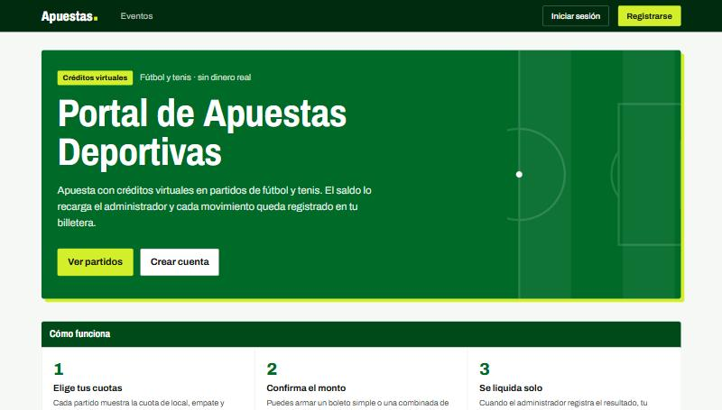
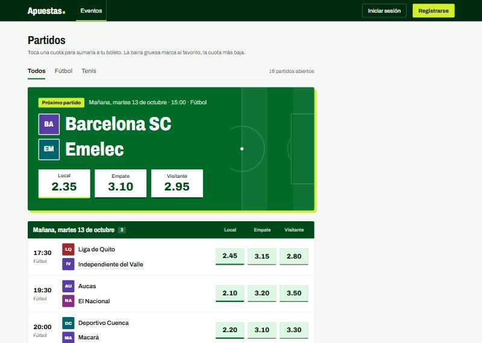
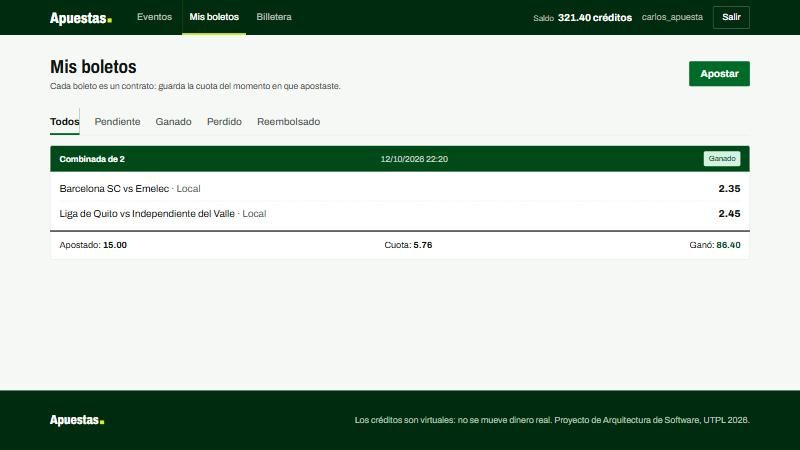
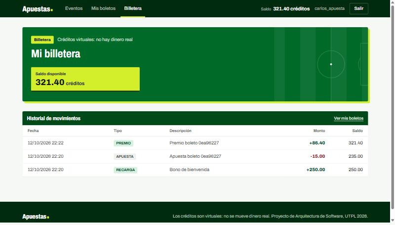
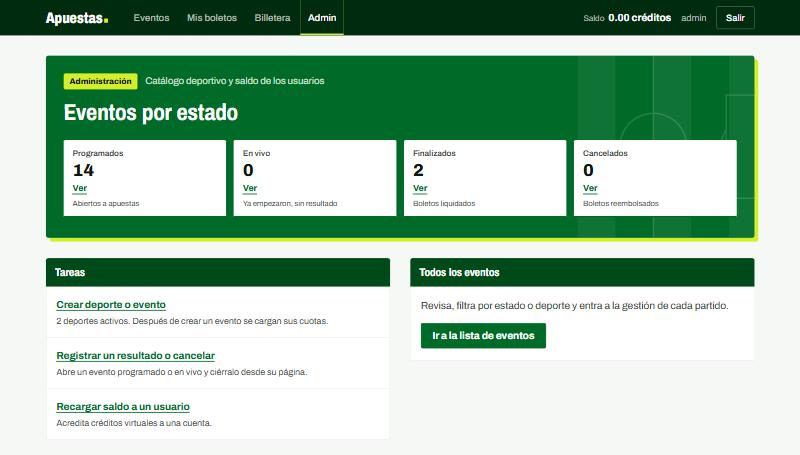
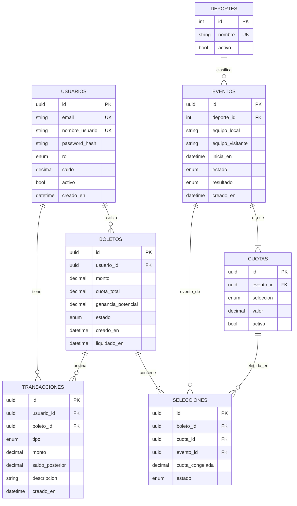

<div align="center">

# Portal de Apuestas Deportivas

**Apuesta con créditos virtuales. Sin dinero real, sin riesgo, con la arquitectura de un sistema que sí lo moviera.**

> [!IMPORTANT]
> **Construido en un solo día.** Es la tarea de Arquitectura de Software (Ingeniería en Ciencias de la Computación, UTPL 2026): el objetivo no era la app más completa, sino demostrar **trabajo en equipo real con ramas de Git** —tres personas, tres ramas, integración por pull request— y **desarrollo potenciado por IA** ([Claude Code](https://claude.com/claude-code)), eligiendo en cada paso la arquitectura que el tiempo y los recursos disponibles permitían, no la más sofisticada posible.

[](https://www.python.org/)
[](https://fastapi.tiangolo.com/)
[](https://www.sqlalchemy.org/)
[](https://htmx.org/)
[](#pruebas)
[](LICENSE)



</div>

## Sobre este proyecto

Trabajo de la asignatura **Arquitectura de Software** — Ingeniería en Ciencias de la Computación, UTPL 2026. Se construyó **en un solo día**, en un equipo de tres, y el código no era el único entregable: el ejercicio pedía demostrar trabajo en equipo real con ramas de Git, saber elegir una arquitectura ajustada a las restricciones del momento —tiempo y recursos limitados, no capacidad técnica— y aprovechar el desarrollo potenciado por IA ([Claude Code](https://claude.com/claude-code)) sin perder el control sobre lo que se construye ni por qué.

El resultado es un sistema completo y probado: registro y autenticación, catálogo deportivo administrable, apuestas simples y combinadas, y liquidación automática de boletos — con 567 pruebas automatizadas respaldando cada regla de negocio.

## Capturas

<table>
<tr>
<td width="50%"><br><sub align="center">Partidos del día con sus cuotas, filtrables por deporte</sub></td>
<td width="50%"><br><sub align="center">Una combinada de dos partidos, ya liquidada</sub></td>
</tr>
<tr>
<td width="50%"><br><sub align="center">El saldo y el libro mayor de cada movimiento</sub></td>
<td width="50%"><br><sub align="center">Panel de administración: eventos, cuotas y resultados</sub></td>
</tr>
</table>

## Qué hace (y qué no, a propósito)

| Sí | No (fuera de alcance, declarado) |
|---|---|
| Registro y login con roles usuario/admin | Dinero real ni pasarelas de pago |
| Saldo en créditos virtuales, recargado por el admin | APIs externas de resultados deportivos |
| El admin carga deportes, eventos y cuotas | Apuestas en vivo con cuotas dinámicas |
| Boletos simples y combinados (hasta 10 selecciones) | Mercados distintos al resultado del partido |
| Liquidación automática e idempotente al registrar un resultado | |
| Reembolso y recálculo si un evento se cancela | |
| Libro mayor inmutable de cada movimiento de saldo | |

Declarar el alcance negativo es intencional: demuestra que las omisiones fueron decisiones de diseño bajo un plazo de un día, no descuidos.

## Decisiones de arquitectura

El ejercicio pedía elegir la arquitectura según los requerimientos reales, no la más sofisticada posible. Con tres personas y un día, cada decisión favoreció velocidad de integración sobre completitud:

| Se eligió | En vez de | Por qué, dado el contexto |
|---|---|---|
| **Monolito modular** por dominio (`usuarios`, `billetera`, `catalogo`, `apuestas`) | Microservicios | Tres personas y 24 horas no alcanzan para orquestación ni despliegue distribuido. El corte por módulo da el mismo aislamiento de código que los microservicios, sin su costo operativo |
| **SQLite** con un tipo de dato propio para dinero | PostgreSQL + Docker | Cero infraestructura: cada integrante clona, migra y corre en minutos. Reiniciar la base es borrar un archivo |
| **Server-rendered** (Jinja2 + HTMX) | SPA (React/Vue) + API separada | Un solo proceso, sin CORS, sin build de frontend ni segundo despliegue que coordinar |
| **Una sola persona genera las migraciones** de Alembic | Cada quien genera las suyas | Evita el historial de Alembic bifurcado que aparece cuando tres personas corren `alembic revision` en ramas paralelas el mismo día |
| **Tres ramas de feature + pull requests a `main`** | Trabajo directo sobre `main` | Permite avanzar en paralelo sin bloquearse y deja un historial de Git real y auditable — la evidencia del trabajo en equipo |

La arquitectura completa, con las reglas de negocio y el detalle de cada decisión, está documentada para que un agente de IA (o cualquier integrante nuevo) pueda retomar el proyecto sin más contexto: [CLAUDE.md](CLAUDE.md).

## Arquitectura

Monolito modular con corte vertical por dominio. Cada módulo es autocontenido — modelo, schema, servicio y router — y nunca importa el modelo de otro módulo, solo su servicio:

```
Router (HTTP)  →  Service (lógica de negocio)  →  Model (tabla)
```

```
app/
├── core/          security.py (JWT + bcrypt), dependencies.py (auth), config.py
├── db/            base.py, enums.py, types.py (Dinero: Decimal en Python, centavos en SQLite)
├── modules/
│   ├── usuarios/      registro, login, roles
│   ├── billetera/     libro mayor, debitar()/acreditar() atómicos
│   ├── catalogo/      deportes, eventos, cuotas, resultados
│   └── apuestas/      boletos, selecciones, liquidación idempotente
└── web/           pantallas Jinja2 + HTMX, una por módulo dueño
```

Siete tablas, una migración, llaves foráneas activas y `CHECK` a nivel de base de datos protegiendo el saldo y las cuotas.

## Modelo de datos



Dos decisiones que no se ven en el diagrama, pero sostienen todo el modelo:

- **`selecciones.cuota_congelada`** copia el valor de la cuota en el instante de apostar. El boleto es un contrato cerrado: si el admin edita la cuota después, las apuestas ya hechas no se enteran.
- **`transacciones` es un libro mayor inmutable** (solo `INSERT`, nunca `UPDATE`/`DELETE`). `monto` lleva signo, así que la suma de los movimientos de un usuario siempre es igual a su `saldo` actual — eso es lo que permite auditar que nunca haya una inconsistencia.

Explicación completa de las siete tablas, cada restricción y un recorrido con datos de ejemplo: [docs/diagrama-base-de-datos.md](docs/diagrama-base-de-datos.md).

## Puesta en marcha

Windows (PowerShell):

```powershell
python -m venv venv
venv\Scripts\Activate.ps1
pip install -r requirements.txt
copy .env.example .env
alembic upgrade head
python -m scripts.seed
uvicorn app.main:app --reload
```

Linux / macOS:

```bash
python3 -m venv venv
source venv/bin/activate
pip install -r requirements.txt
cp .env.example .env
alembic upgrade head
python -m scripts.seed
uvicorn app.main:app --reload
```

Edita `.env` y pon una `SECRET_KEY` propia (`python -c "import secrets; print(secrets.token_urlsafe(48))"`), y crea un administrador:

```bash
python -m scripts.crear_admin --email admin@correo.com --nombre admin
```

La aplicación corre en http://localhost:8000 y la documentación interactiva de la API en http://localhost:8000/docs.

## Pruebas

```bash
pytest
```

567 pruebas cubren el servicio de cada módulo, los endpoints de la API, las pantallas HTML y las migraciones — incluida la aritmética de dinero en centavos, la atomicidad del débito de saldo y la idempotencia de la liquidación.

## Stack

| Capa | Tecnología |
|---|---|
| Lenguaje y framework | Python 3.11+, FastAPI |
| Datos | SQLAlchemy 2.0, Alembic, SQLite |
| Validación | Pydantic v2 |
| Autenticación | JWT (`python-jose`) + `passlib[bcrypt]` |
| Frontend | Jinja2, Tailwind CSS, HTMX |
| Pruebas | pytest |

## Equipo

Desarrollado en un día por tres integrantes, cada uno dueño de un dominio completo — modelo, lógica de negocio, endpoints y pantallas — coordinados con contratos de funciones definidos antes de empezar a programar.

<table>
<tr>
<td align="center" width="33%">
<a href="https://github.com/ricardofel"><br><b>Ricardo E.</b></a><br>
<sub>Identidad y billetera</sub><br>
<sub>usuarios · autenticación · libro mayor</sub>
</td>
<td align="center" width="33%">
<a href="https://github.com/ericroco"><br><b>Erick Rodas</b></a><br>
<sub>Catálogo deportivo</sub><br>
<sub>deportes · eventos · cuotas · administración</sub>
</td>
<td align="center" width="33%">
<a href="https://github.com/Dacampoverde11"><br><b>Daniel Campoverde</b></a><br>
<sub>Apuestas y liquidación</sub><br>
<sub>boletos · selecciones · liquidación idempotente</sub>
</td>
</tr>
</table>

## Documentación

- [CLAUDE.md](CLAUDE.md) — arquitectura, reglas de negocio y convenciones, para retomar el proyecto sin más contexto.
- [docs/diagrama-base-de-datos.md](docs/diagrama-base-de-datos.md) — modelo de datos completo y sus decisiones de diseño.

## Licencia

[MIT](LICENSE).
