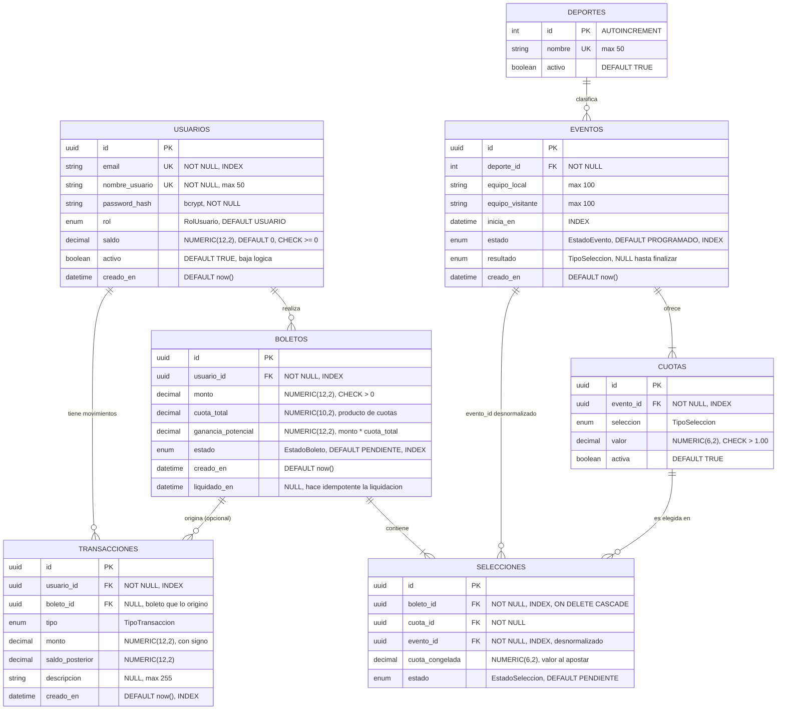

# Diagrama de base de datos

Siete tablas, SQLite. El diagrama usa Mermaid (se renderiza en GitHub y en VS Code con la extensión de Mermaid).

Los tipos `decimal` son lógicamente `NUMERIC(p,s)`, pero en SQLite se implementan con el `TypeDecorator` `Dinero`: `Decimal` en Python y **centavos enteros** en la base. Ver [Consideraciones de SQLite](#consideraciones-de-sqlite).

## Diagrama entidad-relación



## Restricciones únicas compuestas

| Tabla | Restricción | Para qué sirve |
|---|---|---|
| `cuotas` | `UNIQUE (evento_id, seleccion)` | Un evento no puede tener dos cuotas para el mismo resultado |
| `selecciones` | `UNIQUE (boleto_id, evento_id)` | Impide dos selecciones del mismo evento en una combinada |

## Enumeraciones

| Enum | Valores |
|---|---|
| `RolUsuario` | `USUARIO`, `ADMIN` |
| `TipoTransaccion` | `RECARGA`, `APUESTA`, `PREMIO`, `REEMBOLSO` |
| `EstadoEvento` | `PROGRAMADO` (acepta apuestas), `EN_VIVO`, `FINALIZADO` (dispara liquidación), `CANCELADO` (dispara reembolsos) |
| `TipoSeleccion` | `LOCAL`, `EMPATE`, `VISITANTE` |
| `EstadoBoleto` | `PENDIENTE`, `GANADO`, `PERDIDO`, `REEMBOLSADO` |
| `EstadoSeleccion` | `PENDIENTE`, `ACERTADA`, `FALLIDA`, `ANULADA` |

## Decisiones de diseño clave

- **Dinero como `Decimal`, nunca `float`.** `saldo >= 0` está además protegido por un `CHECK` a nivel de base de datos.
- **`transacciones` es un libro mayor inmutable:** solo `INSERT`, nunca `UPDATE`/`DELETE`. `monto` lleva signo, así que la suma de los montos de un usuario debe igualar su `saldo`. `saldo_posterior` permite auditar inconsistencias.
- **`selecciones.cuota_congelada`:** copia del valor de la cuota al apostar. Editar una cuota después no altera boletos ya emitidos (el boleto es un contrato).
- **`selecciones.evento_id` desnormalizado:** habilita el `UNIQUE (boleto_id, evento_id)` y permite que la liquidación encuentre las selecciones de un evento sin JOIN.
- **`boletos.cuota_total` y `ganancia_potencial`:** datos derivados que se guardan a propósito por la misma razón del contrato.
- **`boletos.liquidado_en`:** si ya tiene fecha, la liquidación se salta ese boleto (idempotencia).
- **Baja lógica en `usuarios.activo`:** un usuario con boletos no se puede borrar sin romper integridad referencial.
- **Equipos como texto plano** en `eventos`: no hay tabla `equipos`, decisión consciente por el alcance.
- **`deportes` usa entero autoincremental:** tabla pequeña y estable, UUID no aporta nada.

## Consideraciones de SQLite

1. **Llaves foráneas desactivadas por defecto:** activar `PRAGMA foreign_keys=ON` en cada conexión (listener en `app/db/session.py`).
2. **Sin tipo decimal nativo:** columnas de dinero con `TypeDecorator` `Dinero` (`app/db/types.py`), que guarda centavos enteros. Los `CHECK` se escriben en centavos (`valor > 100` equivale a una cuota mayor a 1.00). Se evitó guardar texto porque SQLite lo compara como cadena y los `CHECK`, el orden y los `SUM` dejan de ser confiables.
3. **Sin bloqueo de filas:** `with_for_update()` se ignora; SQLite serializa escrituras bloqueando toda la base. Se mantiene en el código por portabilidad a PostgreSQL. Activar `PRAGMA journal_mode=WAL` y `timeout` de 15 s.
4. **Alembic en modo batch:** `render_as_batch=True` en `alembic/env.py` y `op.batch_alter_table()` en las migraciones.

| Tipo lógico | Implementación en SQLite |
|---|---|
| UUID | `sqlalchemy.Uuid` (CHAR(32)) |
| SERIAL | `Integer, primary_key=True, autoincrement=True` |
| NUMERIC(p,s) | `Dinero` (TypeDecorator sobre `Integer`, centavos) |
| ENUM | `sqlalchemy.Enum` (VARCHAR + CHECK) |
| TIMESTAMP | `DateTime` |
| BOOLEAN | `Boolean` (INTEGER 0/1) |

## Ejemplo de datos

Usuario con 100 créditos que apuesta 10 en una combinada de dos partidos y gana ambos:

```
usuarios        id=u1, saldo=120.00
boletos         id=b1, usuario=u1, monto=10.00, cuota_total=3.00, ganancia_potencial=30.00, estado=GANADO
selecciones     id=s1, boleto=b1, evento=e1, cuota_congelada=2.00, estado=ACERTADA
                id=s2, boleto=b1, evento=e2, cuota_congelada=1.50, estado=ACERTADA
transacciones   id=t1, usuario=u1, tipo=RECARGA, monto=+100.00, saldo_posterior=100.00
                id=t2, usuario=u1, tipo=APUESTA, monto=-10.00,  saldo_posterior=90.00,  boleto=b1
                id=t3, usuario=u1, tipo=PREMIO,  monto=+30.00,  saldo_posterior=120.00, boleto=b1
```
